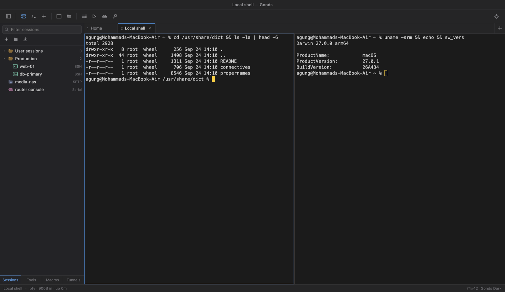
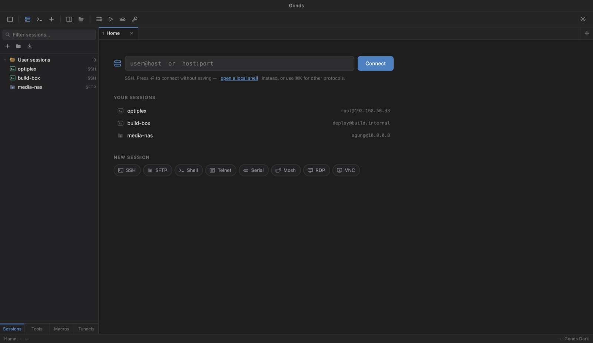

<div align="center">

# Gonds

**A terminal, SSH client and SFTP browser that live in one macOS window.**

Tabs and splits, a session tree you can actually organise, and a file panel that
rides the same SSH connection as your shell — no second login, no second app.

*The name is Indonesian: **gondrong**, long-haired. For the quietly excellent
engineers who never look the part.*

[Install](#install) · [What you get](#what-you-get) · [Design notes](#design-notes) · [Contributing](#contributing) · [Develop](#develop)

<br>



</div>

---

## Install

macOS 11 or newer, Apple silicon. Gonds is **not notarised by Apple** —
notarisation needs a paid Developer account, which this project does not have —
so Gatekeeper gets in the way once. Three ways past it:

**Build it yourself.** Software you compile locally is never quarantined, so
there is no warning at all:

```bash
git clone https://github.com/agungmohmd/gonds.git
cd gonds && npm install && npm run dist
open dist/*.dmg
```

**Download the DMG** from [Releases](https://github.com/agungmohmd/gonds/releases),
drag Gonds to Applications, then clear the quarantine flag once:

```bash
xattr -dr com.apple.quarantine /Applications/Gonds.app
```

**Or let it be blocked,** then click *Open Anyway* in System Settings →
Privacy & Security. On macOS 15 and later, Control-click → Open no longer
works for unsigned apps — ignore any guide that still says it does.

> **First launch asks for Local Network access.** Grant it, or SSH to a
> `192.168.x.x` address fails with `EHOSTUNREACH`. You can change your mind
> later in System Settings → Privacy & Security → Local Network.

## What you get



**Connect fast.** Type `user@host` on the home tab and press return. Nothing to
save, nothing to configure. Press ⌘K for the other protocols.

**Keep your sessions straight.** A tree with real folders, drag to reorder, a
filter box, and a distinct icon per protocol. Import from `~/.ssh/config` or
CSV; export to CSV.

**SSH that behaves like `ssh`.** Password, private key with passphrase prompt,
`ssh-agent` and keyboard-interactive — tried in turn, falling back the way
OpenSSH does, so a host your agent holds no key for still lets you type a
password. Jump-host chains like `ssh -J`. Host keys are checked against Gonds'
own store, and a key that *changed* stops you with a warning rather than a
shrug.

**SFTP without a second connection.** The file panel shares the tab's existing
SSH session. It follows your shell's working directory, takes drag-and-drop
from Finder, transfers directories with progress you can cancel, asks before
overwriting anything, and edits remote text files in place. A dedicated SFTP
session type gives you the two-pane local/remote view.

**A terminal worth using.** xterm.js with true colour and Unicode 11, nested
splits with draggable gutters, find-in-terminal, copy-on-select, multi-line
paste confirmation, and nine colour schemes. Palette keys use PuTTY's names, so
the large pool of existing PuTTY and xterm themes pastes straight in.

**The tools you reach for mid-session.** Broadcast your typing to every
terminal at once, macros, `-L` / `-R` / `-D` port forwarding with a built-in
SOCKS5 server, an SSH key generator, network scanner, netstat, listening ports,
process list and system information.

**Passwords stay in the Keychain** under the service name `Gonds`, so your login
password is the master password. Nothing secret is written to Gonds' own files
— not even into the saved tab layout. No telemetry, no update check, no
analytics, no ads: at idle the app holds zero network sockets, and
[`SECURITY.md`](SECURITY.md) shows you how to check that for yourself.

<br clear="right">

## Design notes

Some things are deliberately **not** reimplemented, because macOS already does
them and a second implementation would only be worse:

| | |
|---|---|
| **RDP, VNC, FTP, web links** | handed to the system client via `rdp://`, `vnc://`, Finder and your browser |
| **X11** | XQuartz. X11 *forwarding* over SSH is implemented; the X server is not |
| **Serial** | `screen /dev/tty.X <baud>` in a pseudo-terminal, not a native serial binding |
| **Credentials** | `/usr/bin/security`, so there is no native Keychain module to rebuild on every Electron upgrade |

Also missing, so you know before you ask: tear-off tab windows, macro
*recording*, XDMCP, session logging to file, dragging from the remote panel
into Finder, and auto-update. Most are written up in
[`docs/TASKS.md`](docs/TASKS.md) and several are an afternoon's work, if you
fancy it.

There is no bundler. The renderer is plain scripts plus the xterm.js UMD build,
so `npm start` runs exactly what you edited.

## Contributing

Side project. No roadmap, no release schedule, no promises. I'd rather build it
with other people than watch it get forked, so I wrote down what needs doing
instead of keeping it in my head.

**[`docs/TASKS.md`](docs/TASKS.md)** has the list — each one small enough to
finish in an evening, with the files it touches and what *done* means. Some of
the easy ones:

- Sort and filter the SFTP file list — it has neither today
- Keyboard navigation in the session tree — it is mouse-only
- Transfer speed and ETA — the data is already emitted, nothing derives it
- A light-theme pass — everything was designed in the dark one
- Cover `-R` and `-D` port forwards in the test suite — only `-L` is exercised

**[`CONTRIBUTING.md`](CONTRIBUTING.md)** covers setup, where things live, house
style, and what I'll say no to. Setup is `npm install && npm start` — no
bundler, no watch process, no build step.

There is also one larger idea on the table: an **optional, bring-your-own-key
AI assistant** — point Gonds at any OpenAI-compatible endpoint, including a
local Ollama, and ask about what is on screen. Off by default, pausable,
nothing sent without asking, and it never runs a command for you. It is a
proposal rather than a plan — the design constraints are written up as task 20
in [`docs/TASKS.md`](docs/TASKS.md), and the argument about them is the part
worth having first.

Bug reports and "this is annoying to use" issues count just as much as patches.
If something made you give up and open a different app, I want to hear it.

## Develop

```bash
npm install
npm start             # run from source
npm test              # 31 unit checks, no framework
npm run smoke         # end to end: boots a throwaway SSH/SFTP server, drives the real UI
npm run smoke:remote  # end to end against a public test server (opt-in, needs network)
npm run dist          # dist/Gonds-<version>-arm64.dmg
```

Packaging details, signing, and what to do when the build misbehaves:
[`docs/BUILD.md`](docs/BUILD.md).

Needs Node 20+.

`npm run smoke` is the interesting one: it starts a real SSH and SFTP server
in-process, launches the app against a throwaway profile, and drives the actual
UI — password prompts, transfers, tunnels, splits — then prints a pass/fail
table and leaves a screenshot behind. It never touches your own sessions.

Release builds are ad-hoc signed under `com.agungmohmd.gonds`. That does not
satisfy Gatekeeper, but it gives the app a stable code identity, which is what
macOS keys privacy permissions on — so Local Network access survives a rebuild.
With a Developer ID the same command signs and notarises; environment only, no
config change:

```bash
GONDS_SIGN_IDENTITY="Developer ID Application: Your Name (TEAMID)" \
APPLE_ID=you@example.com APPLE_APP_SPECIFIC_PASSWORD=xxxx-xxxx-xxxx-xxxx \
APPLE_TEAM_ID=TEAMID npm run dist
```

```
src/main/      Electron main: window, menu, IPC, SSH, pty, SFTP, tools, Keychain
src/renderer/  UI — plain scripts, inline SVG icons, no bundler
test/          selfcheck.js (unit) · sshfixture.js + smoke scenarios (end to end)
scripts/       smoke drivers, icon generator
docs/          build notes, and the problems that cost time
```

[`docs/SESSION-STATE.md`](docs/SESSION-STATE.md) records what's verified, what
isn't, and every trap I walked into — worth a read before you touch the build.
[`SECURITY.md`](SECURITY.md) is the honest version of what this does and
doesn't protect.

## Licence

Code is [MIT](LICENSE). Third-party components keep their own: xterm.js, ssh2,
node-pty and Electron are all MIT too. Every icon in the interface was drawn for
this project and is covered by the same licence — no icon set, no attribution
needed.

**The name "Gonds" and the application icon are excluded.** They identify this
application, and the icon depicts its author. Fork freely under the MIT terms —
just ship yours under your own name and mark. Better still,
[come work on this one](#contributing).
